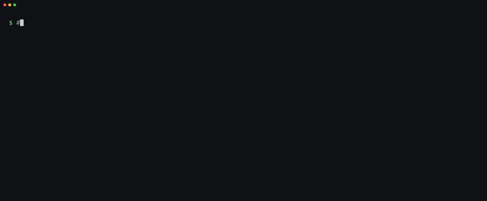

# skill-freshness

[](https://github.com/kvozianov/skill-freshness/actions/workflows/ci.yml)
[](LICENSE)
[](https://agentskills.io/specification)


**Find the agent skills on your machine that are broken, outdated, duplicated, or already built into your agent.**



<sub>Status and recommendation columns from a real `/skill-freshness --quick` run on the test fixture in [`evals/fixtures`](evals/fixtures/make-home.sh), text unedited. The full report also has sources, details and a `--fix` checklist.</sub>

You install skills for Claude Code, Codex, Cursor, Gemini, Copilot… and they quietly rot.
A CLI disappears, an upstream repo moves on, a model id gets retired, or the agent ships
the feature natively (Claude Code added `/loop`, and every "looper" skill became dead
weight). `skill-freshness` is a skill that audits all of them at once and tells you,
with sources, what to keep, update, replace or delete. It never changes anything until
you confirm each item.

```
/skill-freshness              audit everything
/skill-freshness defuddle     one skill, every copy of it
/skill-freshness --fix        then apply the fixes you approve, one by one
```

## What it checks

| Question | How |
|---|---|
| **Where are my skills, and which agent actually loads them?** | Scans every known skill folder (Claude Code, Codex, Gemini CLI, Antigravity, Cursor, Copilot, OpenCode, Qwen Code, Kilo Code, Roo Code, Windsurf, the shared `~/.agents/skills` store, plugins, project folders) and sweeps your home folder for the rest. Flags copies no installed agent reads, nested `SKILL.md` files that never load, and duplicates (identical vs diverged). |
| **Does it still work?** | Is the CLI it calls on `PATH`? Do its scripts compile? Are its Python modules importable? Do the files it references exist? Optional `--smoke` runs scripts with `--help`. |
| **Is it outdated?** | Compares with the upstream repo, the npm / PyPI version, the lockfile of the `skills` CLI; checks doc links and model ids. |
| **Is it now built in?** | Matches the skill's purpose against a dated reference of each agent's built-in commands, tools and hooks, then searches the agent's changelog for anything newer than the skill. |
| **…on the way *you* run it?** | Features differ by surface. The Claude desktop app has a browser pane and an iOS simulator; the terminal CLI does not. Codex schedules tasks only in its desktop app. A skill is marked *superseded* only if the replacement exists on every surface you use. |

Every verdict is one of `actual`, `outdated`, `broken`, `superseded`, `orphan`, with a
confidence level, a cited source, and a concrete recommendation. Anything the audit
could not verify is listed as such instead of being quietly rated "fine".

## Install

**One command, every agent you have** (macOS / Linux):

```bash
curl -fsSL https://raw.githubusercontent.com/kvozianov/skill-freshness/main/install.sh | bash
```

It clones the skill to `~/.agents/skills/skill-freshness` (read by Codex, Cursor,
Copilot, OpenCode and Gemini CLI) and links it into `~/.claude/skills` and the other
agents' folders that exist on your machine. Re-run it to update. Read
[install.sh](install.sh) first if you prefer.

**As a Claude Code plugin** (Claude Code 2.1.275+):

```
/plugin install skill-freshness --marketplace kvozianov/skill-freshness
```

**With the `skills` CLI:**

```bash
npx skills add kvozianov/skill-freshness -g -a claude-code -a codex
```

**By hand** (any agent): clone this repo into the agent's skills folder, e.g.

```bash
git clone https://github.com/kvozianov/skill-freshness ~/.claude/skills/skill-freshness
```

Requirements: Python 3.9+ (standard library only), macOS or Linux. Node is optional (used to check
JavaScript scripts). Web research uses your agent's own web search tool.

## Usage

Ask in plain words or use the command:

- "check which of my skills are outdated" / `/skill-freshness`
- "audit only my Codex skills" / `/skill-freshness --host codex`
- "is defuddle still working?" / `/skill-freshness defuddle`
- "quick local check, no web" / `/skill-freshness --quick`
- "clean them up" / `/skill-freshness --fix`

On the first run the skill asks which agents you use and how (terminal, desktop app,
IDE) unless it can tell for sure, and remembers the answer in
`~/.config/skill-freshness/profile.json`.

The report is saved as `skill-freshness-report-<date>.md` in the current folder.
See a real one: **[examples/report-2026-10-27.md](examples/report-2026-10-27.md)**
(95 skills across Claude Code and Codex: an Obsidian plugin 25 releases behind, two
CLIs missing, 14 nested copies no agent loads, and more).

### `--fix` is careful by design

- Each change is shown and confirmed separately.
- Deleting means moving to `<skills-folder>/.skill-freshness-trash/<date>/`, never `rm -rf`.
- A `SKILL.md` is backed up before it is edited.
- Updates use the upstream's own installer, not hand-copied files.
- Vendor-managed skills and plugin caches are never touched.

## The scanner on its own

The deterministic part is a single Python script you can run without any agent:

```bash
python3 scripts/scan.py --env              # agents installed, their surfaces, current session
python3 scripts/scan.py --check --md       # every skill, who loads it, dependency problems
python3 scripts/scan.py --host codex --only last30days --check
python3 scripts/scan.py --check --out inventory.json
```

It only reads files and runs `--version` / syntax checks (`--smoke` adds `--help`).

## How it's tested

- **Scanner:** 31 unit tests on synthetic home folders (symlinked copies, nested clones,
  diverged duplicates, missing CLIs, broken scripts, invalid YAML, surface detection), run in
  CI on Linux and macOS together with the official Agent Skills validator.
- **Behaviour:** 4 end-to-end cases run with `claude plugin eval` against a fixture home that
  contains known problems (a missing CLI, a script with a syntax error, a skill made redundant
  by `/loop`, a diverged duplicate, a nested clone, stale model ids). Each case also runs
  without the skill as a baseline.

| Case | With skill | Without |
|---|---|---|
| Full audit, `--quick` | 1.00 | 0.25 |
| Russian prose request, Claude Code + Codex | 1.00 | 0.33 |
| One skill with a missing CLI | 1.00 | 0.33 |
| Terminal-only user keeps their browser skill | 1.00 | 0.67 |

One run per case on 2026-10-28; rerun with `claude plugin eval . --scaffold`.
Automatic triggering from free-form requests is conservative (it never fired on
look-alike requests, and fires on a minority of genuine ones when a hundred other skills
compete), so the reliable entry point is `/skill-freshness`.

## Supported agents

Claude Code, OpenAI Codex, Gemini CLI, Google Antigravity, Cursor, GitHub Copilot
CLI, OpenCode, Qwen Code, Kilo Code, Roo Code, Windsurf, plus any folder that follows
the `.agents/skills` convention. Adding an agent is a JSON entry in
[scripts/hosts.json](scripts/hosts.json); its built-in features go in
`references/hosts/<id>.md`.

## Repository layout

```
SKILL.md                     the skill: triggers, arguments, audit workflow
scripts/scan.py              scanner (stdlib only)
scripts/hosts.json           agent registry: skill folders, binaries, apps, IDE extensions
references/hosts/*.md        dated built-in feature baselines per agent, with surfaces
references/audit-checklist.md   statuses, evidence rules, the surface rule, what --fix may do
references/report-template.md
examples/                    a real report
evals/                       test cases (claude plugin eval format)
tests/                       scanner tests (python3 -m unittest discover -s tests)
.claude-plugin/              Claude Code plugin + marketplace manifests
install.sh
```

## Keeping it current

The per-agent references are dated snapshots. Each audit compares the snapshot with
the installed agent version and reads the changelog for anything newer, then offers to
update the reference. Pull requests with new agents or newer baselines are welcome.

## License

MIT © Kirill Vozianov
